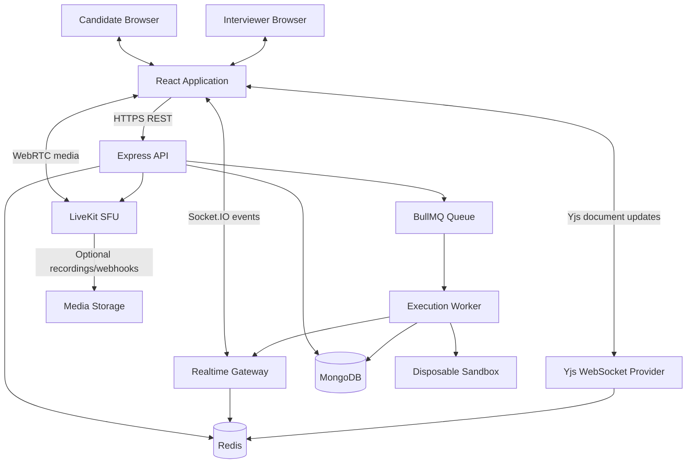
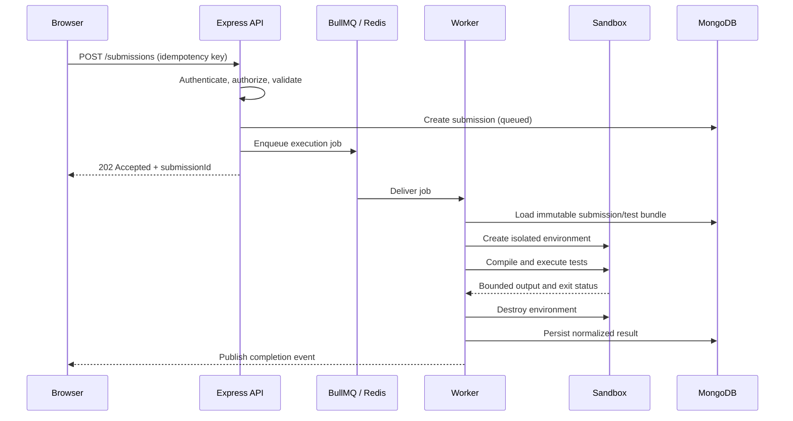

# System Architecture

## 1. Architecture decisions

| Concern                  | Decision                                                                          |
| ------------------------ | --------------------------------------------------------------------------------- |
| Frontend                 | React + TypeScript                                                                |
| Editor                   | Monaco Editor                                                                     |
| Backend                  | Node.js + Express                                                                 |
| Application architecture | MVC within a modular monolith                                                     |
| Database                 | MongoDB + Mongoose                                                                | mongodb atlas |
| Queue/cache              | Redis + BullMQ                                                                    |
| Collaboration            | Yjs with a WebSocket provider                                                     |
| Socket transport         | Socket.IO for application events/presence; Yjs updates over a compatible provider |
| Code execution           | Separate worker service using disposable containers                               |
| Initial isolation        | Hardened Docker; evaluate gVisor before public untrusted workloads                |
| Voice/video              | LiveKit (WebRTC/SFU)                                                              |
| Media assets             | Cloudinary where its media features fit                                           |
| General object storage   | Cloudflare R2 or another S3-compatible provider, optional                         |
| AI (Stage C)             | Provider-agnostic adapter/service                                                 |

## 2. High-level system



## 3. Control plane and execution plane

### Control plane

The Express application, realtime services, database, and queue coordinate users and work:

- Authentication and authorization.
- Organization and interview lifecycle.
- Question and test-case management.
- Submission intake.
- Queue creation and status tracking.
- Collaboration room authorization.
- LiveKit token issuance.
- Evaluation and audit records.

The control plane must never execute candidate source code directly.

### Execution plane

Execution workers consume jobs and run code via isolated execution backends:

- **Asynchronous Decoupling**: Express API saves the submission record with `status: "queued"`, enqueues a job into the BullMQ `code-execution` queue over Upstash Redis with TLS, and immediately returns `202 Accepted` to the client. The API process never runs candidate code.
- **Dedicated Execution Worker (`apps/worker`)**: A standalone Node.js process listens on the `code-execution` queue with configurable concurrency (default: 5 concurrent jobs).
- **Execution Provider Abstraction**:
  - `ExecutionProvider`: Pluggable abstract interface defining `execute()` and `ping()`.
  - `Judge0ExecutionProvider`: Production provider communicating over a backend-only REST API with self-hosted Judge0 Community Edition. Base64 encodes code and inputs, configures wall-clock timeouts and memory limits, handles compilation errors, and truncates large outputs to 64 KB.
  - `MockExecutionProvider`: Deterministic provider for CI and unit test environments with zero external dependencies.
- **Public vs. Hidden Test Evaluation**:
  - "Run Code" (`submissionType: "run"`): Evaluates only public test cases.
  - "Submit Solution" (`submissionType: "submit"`): Evaluates all public test cases plus private hidden test cases.
  - Compilation errors on test 1 immediately abort remaining test runs to save compute.
- **Persistence & Realtime Event Propagation**:
  - The worker updates MongoDB Atlas directly with the normalized `executionResult` and sets status to `"completed"` or `"failed"`.
  - The worker publishes an event to the Upstash Redis pub/sub channel `submission:events`.
  - The API's `execution-events.subscriber.js` receives the pub/sub event and broadcasts it over Socket.IO to `interview:${interviewId}` room participants (`submission:completed` or `submission:failed`), strictly masking hidden test inputs and expected outputs before candidates can observe the payload.

Use a separate host/VM or isolated worker pool for execution. Do not mount the host Docker socket into the Express API container. Worker credentials must not permit broad database or organization access.

## 4. Backend module boundaries

Each module owns its routes/controllers, service layer, validation, and data access.

```text
src/
  app.js
  server.js
  config/
  shared/
    errors/
    middleware/
    validation/
    logger/
    events/
  modules/
    auth/
      auth.routes.js
      auth.controller.js
      auth.service.js
      auth.model.js
      auth.validation.js
    users/
    organizations/
    memberships/
    invitations/
    interviews/
    questions/
    submissions/
    evaluations/
    audit/
    realtime/
    media/
  infrastructure/
    database/
    redis/
    queues/
    livekit/
    storage/
workers/
  execution/
    worker.js
    job-handler.js
    sandbox-manager.js
    runtimes/
      javascript.js
      python.js
      cpp.js
```

The user requested MVC. Apply MVC within each module:

- **Model:** Mongoose schema/model and persistence concerns.
- **Controller:** HTTP request/response mapping; no business rules.
- **Service:** business rules and orchestration.
- **Routes:** endpoint registration and middleware.
- **Validation:** request schemas and payload validation.

Avoid a single global `models/` folder that causes every module to reach into every other module's data. A shared module may expose a narrow service interface.

## 5. Collaboration architecture

### Yjs & Socket.IO Collaboration Bridge

In Phase 3, real-time collaboration combines Yjs CRDT document convergence with a specialized Socket.IO binary/base64 protocol:

1. **Namespace & Scoping**: Each question in an interview has a dedicated collaborative document (`interviewId:questionId`). Documents are isolated across interviews and questions.
2. **Server-Side Y.Doc Authority**: The API maintains an in-memory `Y.Doc` map managed by `collaboration.service.js`. Incoming differential updates are applied to the server document and broadcast exclusively to authorized room participants.
3. **Durable Persistence Strategy**:
   - Initial document state is loaded from MongoDB (`CodeDocument` collection).
   - If no prior document exists, starter code for the active question is seeded automatically.
   - Updates are debounced by 1.5 seconds to batch write operations, avoiding a MongoDB write on every keystroke.
   - Binary Yjs state snapshots (`Y.encodeStateAsUpdate`) and clean text extractions are stored in MongoDB Atlas.
4. **Client-Side Monaco Binding**: The frontend uses `y-monaco` to bind the Monaco Editor model to the shared Yjs `Text` type, providing zero-conflict collaborative typing and syntax highlighting across JavaScript, Python, and C++.

### Dual-Authentication & Room Security

- **Interviewer & Team Members**: Authenticated via standard short-lived JWT access tokens and checked against active database sessions and organization role permissions (`owner`, `admin`, assigned `interviewer`).
- **Candidates**: Authenticated via single-use candidate invitation tokens exchanged for short-lived, scoped candidate room JWTs (`type: "candidate_room"`).
- **Socket.IO Handshake Guard**: All socket connections authenticate at handshake time. Unauthenticated or uninvited connections are rejected before room subscription.
- **Question Sanitization**: Candidate room endpoints sanitize question snapshots, ensuring hidden unit tests and expected outputs are never delivered to candidate browsers.

## 6. Voice and video architecture (LiveKit)

LiveKit provides WebRTC audio/video communication:

1. **Token Service (`livekit.service.js`)**: Generates cryptographically signed access tokens using `livekit-server-sdk` scoped to room `interview_${interviewId}`.
2. **Role-Based Grants**:
   - Interviewers receive `roomAdmin: true`, `roomJoin: true`, `canPublish: true`, `canSubscribe: true`.
   - Candidates receive `roomJoin: true`, `canPublish: true`, `canSubscribe: true`.
3. **Graceful Fallback**: If LiveKit credentials (`LIVEKIT_API_KEY`, `LIVEKIT_API_SECRET`) are not configured in local development, the backend flags `isLiveKitConfigured: false` and the frontend gracefully displays media controls in an inactive state without breaking the interview session.

## 7. Execution architecture



### Queue rules

- Queue payload contains identifiers and immutable version references, not unrestricted database credentials or huge source bundles.
- Use a stable job ID or idempotency key to prevent duplicate submissions.
- Distinguish candidate outcomes from infrastructure failures.
- Retry only transient infrastructure failures with bounded attempts and backoff.
- Never retry a deterministic compile error or failed test as if it were a transient worker error.
- Enforce per-organization and global concurrency limits.
- Set queue retention/cleanup policies and dead-letter handling.

### Sandbox baseline

- Dedicated execution hosts/VMs.
- Fresh container per run or per strictly isolated job.
- Non-root UID/GID.
- No privileged mode, host PID/network namespace, or Docker socket.
- Drop Linux capabilities; apply seccomp/AppArmor or equivalent.
- Network disabled by default.
- Read-only root filesystem where practical.
- Bounded writable temporary directory.
- CPU, memory, PID, disk, and wall-time limits.
- Kill process tree on timeout.
- Capture bounded stdout/stderr; prevent output flooding.
- Destroy container and temporary files in a `finally`/cleanup path.
- Keep test harness and hidden cases out of candidate-visible output.
- Consider gVisor or Firecracker before accepting arbitrary internet traffic or high-risk multi-tenant workloads.

Docker isolation is not a complete security boundary. The deployment threat model must include container escape, kernel vulnerabilities, denial of service, malicious compiler inputs, and worker compromise.

## 8. Storage decisions

### MongoDB

Store structured application records: users, organizations, interviews, questions, submissions, execution results, evaluations, and audit events.

### Cloudinary

Use for media assets when transformations, playback delivery, and media management are useful. Do not use Cloudinary as the primary store for source code, hidden test cases, or high-volume execution logs.

### General object storage

If large artifacts are needed, use Cloudflare R2 or another S3-compatible object store for recordings, exports, and long-term logs. Keep object keys private and issue short-lived signed URLs after authorization. The system can start without this dependency.

### Ephemeral execution files

Keep source, compiled binaries, and test working files on bounded ephemeral worker storage. Delete after execution.

## 9. Stage C AI extension points

Add AI as a separate module/service, not as a dependency of the execution engine.

Possible interfaces:

- `AssessmentBlueprintService`: JD + company constraints -> draft blueprint.
- `FollowUpSuggestionService`: interview context + rubric -> interviewer-only suggestions.
- `CodeExplanationService`: source + compiler/runtime/test evidence -> explanation.
- `EvidenceSummaryService`: notes + events + submissions -> cited draft summary.

All AI outputs must be marked as suggestions, preserve provenance, and require human review. Do not send hidden test data, secrets, or unnecessary personal information to an LLM provider.

## 10. Deployment topology

Initial environments:

- Frontend web application.
- Express API service.
- Realtime/Yjs service (can initially share a process, but isolate logically).
- BullMQ execution worker service on separate compute.
- MongoDB managed instance or secured deployment.
- Redis managed instance or secured deployment.
- LiveKit Cloud initially, or self-hosted LiveKit when operational capability exists.
- Cloudinary for selected media.
- Optional Cloudflare R2 for general objects.

Use separate development, staging, and production credentials and databases. Execution workers should be deployed in a restricted network segment.

## 11. Observability

- Structured JSON logs with request ID, interview ID, submission ID, and worker job ID.
- Never log passwords, tokens, raw hidden tests, or unnecessary candidate code.
- Metrics: queue depth, wait time, execution duration, worker utilization, timeout rate, sandbox cleanup failures, socket reconnects, room participant counts, and API latency.
- Health and readiness checks for API, Redis, MongoDB, workers, and realtime services.
- Alerts for queue backlog, worker crash loops, abnormal resource use, and cleanup failures.
